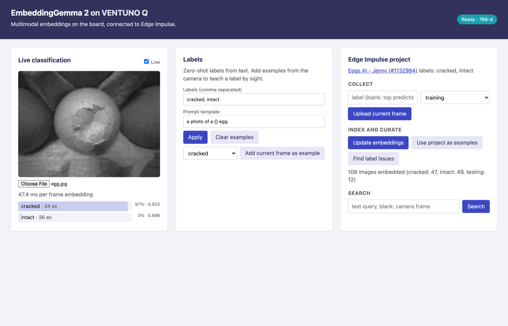
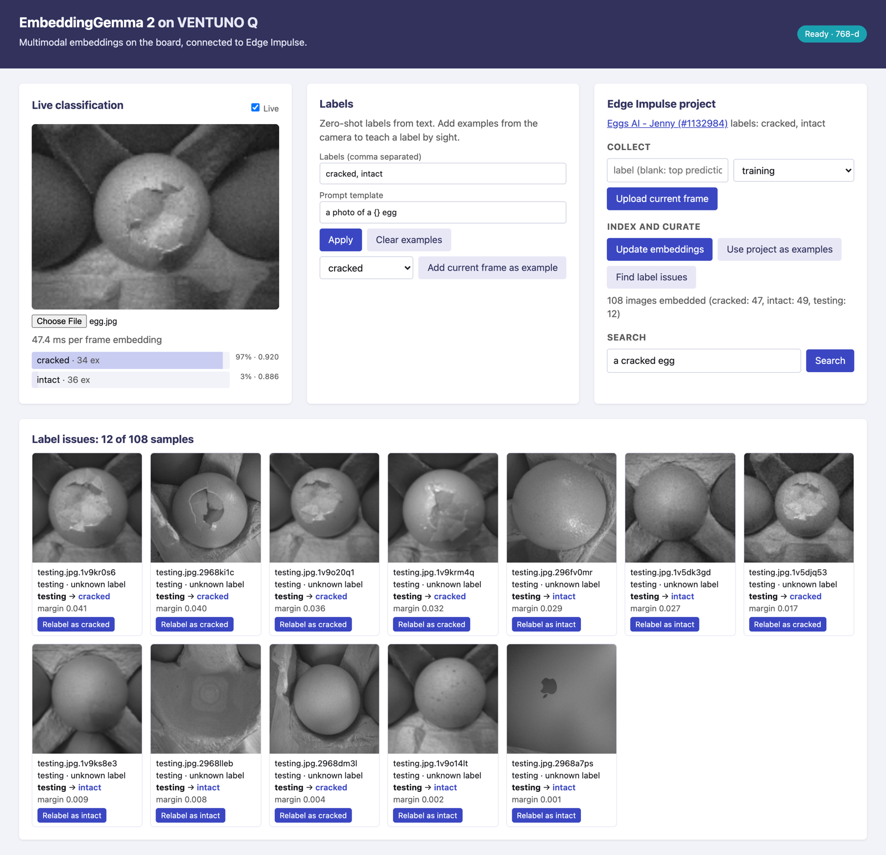
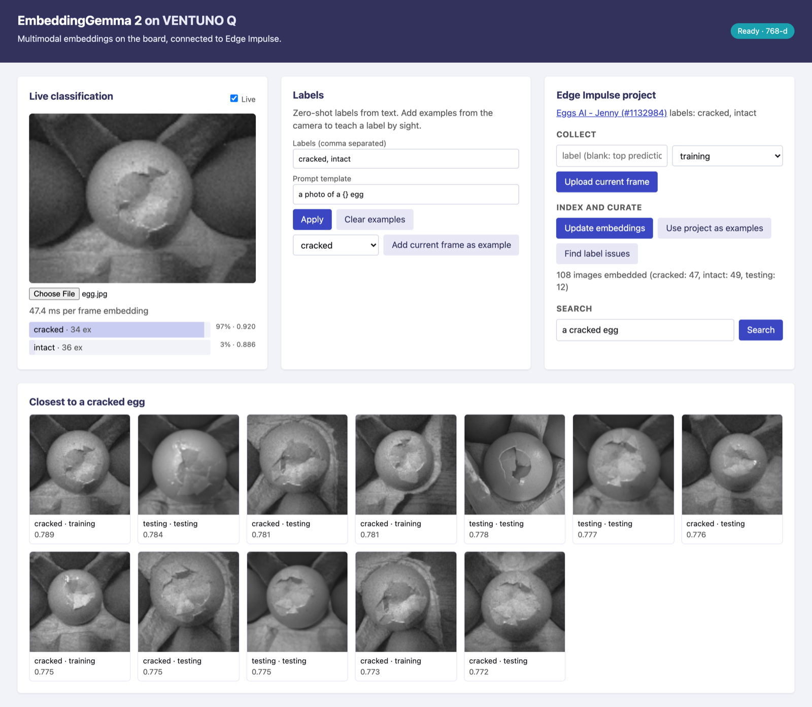

<!--
DRAFT. Not reviewed or approved. See the Review list at the end before publishing.
-->

## Metadata

| Field | Value |
| --- | --- |
| Headline options | 1. Zero-Shot Labels and Dataset Cleanup on Arduino VENTUNO Q With EmbeddingGemma 2 (recommended: names the technique, the board, and the model)<br>2. Start Classifying Before You Train: EmbeddingGemma 2 on Arduino VENTUNO Q<br>3. Use a Multimodal Embedding Model to Bootstrap and Clean an Edge Impulse Dataset |
| Dek (custom excerpt) | Type your labels, point the camera, and get a working image classifier on the Arduino VENTUNO Q. Then use the same embeddings to find label mistakes before you train the model you deploy. |
| Meta title | EmbeddingGemma 2 on Arduino VENTUNO Q With Edge Impulse |
| Meta description | Run EmbeddingGemma 2 in an Arduino App Lab app on VENTUNO Q to classify camera frames from label names, find label issues, and train a compact model. |
| Primary tag | edge ai |
| Secondary tags | Computer Vision, Projects, arduino |
| Author | Jenny Speelman |
| Publish date | [TBD] |
| Post type | Technical deep dive with a getting-started section |

**Feature image brief:** The Arduino VENTUNO Q board next to a screenshot of the app's live classification card, with the Edge Impulse and Arduino logos on the Edge Impulse brand background. Use the official logo files only. Alt text: "An Arduino VENTUNO Q board beside a screen showing a cracked egg classified with 97% confidence."

---

# Zero-Shot Labels and Dataset Cleanup on Arduino VENTUNO Q With EmbeddingGemma 2

The slow part of a new vision project is often the start. Before a model can tell two things apart, you need a labeled dataset, and you usually don't know yet which labels you need. Then the dataset turns out to have unlabeled samples and wrong labels, and you find out after a training run.

We built an Arduino App Lab app that moves some of that work to the front. It runs Google EmbeddingGemma 2 on the Arduino VENTUNO Q, so you can type a few labels, point a camera at something, and get a classifier with no training run. It connects to an Edge Impulse project, so the same embeddings also help you collect data, find label problems, and relabel samples. Edge Impulse Studio then turns that clean dataset into a compact model built for your target. EmbeddingGemma 2 gets you to good data faster, and the model you train in Studio is the one you deploy.

## What an embedding model gives you

EmbeddingGemma 2 turns text or an image into a vector of 768 numbers. Similar meaning gives nearby vectors. Text and images share one space, so you can compare a photo directly with a phrase such as "a photo of a cracked egg."

That one property supports four jobs in the app:

1. **Zero-shot classification.** Each label becomes a text vector. A camera frame is embedded and scored against every label vector, and the scores go through a softmax.
2. **Few-shot classification.** You add labeled frames as examples. The app averages them into one image vector per label and blends it with the text vector (30% text, 70% image), so a few examples correct a weak prompt.
3. **Search.** Every image in the project is embedded once and cached. You can then rank the dataset by similarity to a text query or the current frame.
4. **Label checks.** Each sample is compared with the other samples of each label. A sample can't vote for its own label. If it sits clearly closer to a different label, the app flags it.

## How it runs on the VENTUNO Q

The [Arduino VENTUNO Q](https://docs.arduino.cc/hardware/ventuno-q/) pairs a Qualcomm Dragonwing IQ8 processor running Ubuntu with an STM32H5F5 microcontroller. Arduino App Lab combines sketches, Python, and AI models into apps that run on the board, and this project is one of those apps.

The app uses three bricks from `app.yaml`:

- `arduino:web_ui` serves the browser interface on port 7000.
- `embedding_gemma` runs a llama.cpp server container (`llama-server --embedding`) with the `ggml-org/embeddinggemma-2-GGUF:Q8_0` model. Images are capped at 70 vision tokens, and vectors are L2-normalized so a dot product is cosine similarity.
- `edge_impulse` is a small client for the Studio and Ingestion APIs. It reads samples, uploads frames, and relabels.

The embedding model runs on the board CPU. The first start downloads about 0.9 GB of weights from Hugging Face, and later starts work offline.

## The loop: bootstrap, collect, audit, train

### 1. Bootstrap with text

Type your labels in the app, set a prompt template such as `a photo of a {} egg`, and select **Apply**. The live card scores each camera frame against the labels. No camera? Choose an image instead.


Zero-shot and few-shot classification of an egg image. The label rows show the number of examples behind each label.

The prompt matters more than you might expect. On our test project, the same two labels scored very differently with and without a one-line prompt (see the results below).

### 2. Collect into Edge Impulse

Connect a project by pasting a project API key (**Dashboard > Keys** in Studio) or by setting the `EI_API_KEY` secret on the `edge_impulse` brick. Then use **Upload current frame** to send frames to the project as `training` or `testing` samples. You can pass your own label or use the top prediction. The app doesn't store the API key. It stays in memory for the session.

### 3. Find label issues

**Update embeddings** embeds every image in the project. **Find label issues** then flags unlabeled samples and samples whose label disagrees with their neighbors.

On the Eggs AI project we used for testing, the app embedded 108 images (47 cracked, 49 intact, and 12 that carried the label `testing`) and flagged those 12. Each one comes with a suggested label, a margin, and a **Relabel** button that writes the change back to the project.


Twelve of 108 samples flagged. The margin shows how clearly one label beats the next.

Treat the suggestions as a review queue, not an answer. In our run, the last thumbnail in the grid isn't an egg at all, and the suggestion for it ("intact") is wrong. Low margins are the ones to check by eye. The app ignores mismatches below a margin of 0.01, because below that they were mostly noise on test data.

The same index powers search, so you can type "a cracked egg" and see the closest project images.


Text search over the project's images.

### 4. Train the model you deploy

When the dataset is clean, go back to Studio. [create an impulse](https://docs.edgeimpulse.com/studio/projects/impulse-design), train, and deploy as usual. You can run the result on the VENTUNO Q through Arduino App Lab, or with `edge-impulse-linux-runner`, which uses hardware acceleration on the Hexagon NPU. See the [VENTUNO Q guide](https://docs.edgeimpulse.com/hardware/boards/arduino-ventuno-q) and [Run Arduino App Lab](https://docs.edgeimpulse.com/hardware/deployments/run-arduino-app-lab) in the docs.

## Results on the Eggs AI project

We checked the approach with `tools/eval_ei_project.py`. It scores cached embeddings for 69 training images and 27 testing images labeled `cracked` or `intact`. The 12 samples labeled `testing` are skipped.

| Method | Accuracy |
| --- | --- |
| Zero-shot, label names only | 51.9% |
| Zero-shot, prompt `a photo of a {} egg` | 88.9% |
| Few-shot (training prototypes plus text) | 96.3% |
| 1-NN (nearest training image) | 100% |

The prompt template added 37 points to the same labels. A few examples then closed most of the remaining gap.

## Limitations

- **Small test.** This is one project with 27 test images. Treat the numbers as indicative, not as a benchmark.
- **A data tool, not a deployment.** An embedding model is larger than the compact model you'd ship. Use it to get to a good dataset faster, then train a model sized for your target.
- **Prompts are fragile.** Label names alone scored 51.9%. Test your prompt template before you trust the scores.
- **Writes to your project.** Upload and relabel change the project in Studio. Use a test project or a clone while you try it.
- **Latency.** [TBD: measured per-frame embedding time on the VENTUNO Q. The repo's figure of about 50 ms was measured on a development machine, not on the board, so we don't state it here.]

## Try it yourself

You need an Arduino VENTUNO Q set up with Arduino App Lab, a camera (optional), and an Edge Impulse project with an image dataset.

1. Copy the `app/` folder to the board as an App Lab app, or open it in App Lab.
2. Start the app. Wait for the status pill to read **Ready · 768-d**.
3. Connect your Edge Impulse project with an API key.
4. Enter your labels, apply a prompt template, and watch the live card.
5. Run **Update embeddings**, then **Find label issues**, and review the suggestions.
6. Train and deploy your compact model in Studio.

Source: [github.com/edgeimpulse/embedding-gemma2-ventuno-q](https://github.com/edgeimpulse/embedding-gemma2-ventuno-q) [TBD: confirm the repo is public and the license before linking].

## Get started

The loop in this post has three parts: an Arduino board, an Edge Impulse project, and the code that connects them. Here is how to start on each.

- **Create a free Edge Impulse account.** [Sign up for a free Developer plan account](https://studio.edgeimpulse.com/signup) and start building.
- **Create an Arduino account.** [Sign up at Arduino](https://login.arduino.cc/login) to use Arduino App Lab, and use the same email address as your Edge Impulse account so your models show up in App Lab.
- **Install the Edge Impulse agent skills.** If you build with a coding agent, the [Edge Impulse Agent Skills](https://github.com/edgeimpulse/agent-tools) teach it how to work with Edge Impulse. Install the whole catalog in one command:

  ```bash
  npx skills add edgeimpulse/agent-tools --all
  ```

  That adds every skill to each coding agent it detects, including `ei-build-arduino-uno-q-app-lab` for App Lab apps, bricks, model integration, and Flask UIs, and `ei-api` for the Studio and Ingestion APIs. Some skills in the catalog are experimental and may change. To see what's available before you install, run `npx skills add edgeimpulse/agent-tools --list`.

Join us in the [Edge Impulse forum](https://forum.edgeimpulse.com/), our [Discord server](https://discord.gg/edgeimpulse), or tag us on social media. We'd love to see what you're building.

---

## Promotion kit

**LinkedIn** (under 700 characters, one link, two or three hashtags):
Starting a vision project usually means labeling data before you know which labels you need. We built an Arduino App Lab app that runs EmbeddingGemma 2 on the Arduino VENTUNO Q so you can type labels, point a camera, and classify with no training run. The same embeddings help you find label mistakes in your Edge Impulse dataset before you train the model you deploy. Code, screenshots, and results on a small egg-inspection project: [link] #EdgeAI #Arduino #ComputerVision

**X or Bluesky** (under 280 characters):
Classify camera frames on the Arduino VENTUNO Q from label names alone, then use the same EmbeddingGemma 2 embeddings to find label issues in your Edge Impulse dataset. Walkthrough and code: [link]

**Newsletter blurb** (under 50 words):
Type your labels, point the camera, and classify on the Arduino VENTUNO Q with EmbeddingGemma 2. Then use the same embeddings to catch label mistakes in your Edge Impulse dataset before you train. Read the walkthrough.

## Review list

| Item | Source | Approver | Status |
| --- | --- | --- | --- |
| Repo is public and license (MPL-2.0 in repo, README says "Internal repo. Not reviewed for public release.") | README.md | Open source review (ei-review-osr), legal | Pending |
| Accuracy table (51.9%, 88.9%, 96.3%, 100%) on 27 test images | README.md, `tools/eval_ei_project.py` | Product or applied research | Pending |
| Per-frame latency on the VENTUNO Q | Not measured on board | Engineering | Missing |
| Screenshots show project "Eggs AI - Jenny (#1132984)". Confirm the project name and ID can be public | docs/images/curate.png, classify.png | Jenny Speelman | Pending |
| VENTUNO Q description and Arduino/Qualcomm trademarks | docs.arduino.cc | Arduino, brand | Pending |
| Third-party model: Google EmbeddingGemma 2 (Gemma terms of use) | Hugging Face model card | Legal | Pending |
| Campaign ID for tracked signup link | Marketing | Marketing | Pending |
| Feature image and logos | Brand assets | Design | Pending |
